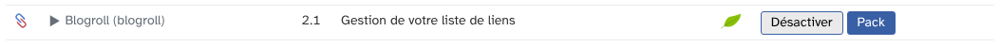
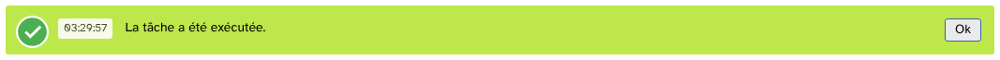
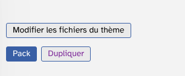

# tinyPacker : guide d'utilisation

tinyPacker ajoute un bouton « Pack » aux gestionnaires d'extensions et de thèmes. Un clic crée l'archive zip du module, prête à être installée ailleurs ou envoyée à quelqu'un.

Le plugin n'a pas de page d'administration. Il est réservé aux super-administrateurs.

## Sommaire

* [Empaqueter un plugin](#empaqueter-un-plugin)
* [Empaqueter un thème](#empaqueter-un-thème)
* [Récupérer l'archive](#récupérer-larchive)
* [Bon à savoir](#bon-à-savoir)

## Empaqueter un plugin

1. Ouvrez « Plugins » dans le menu « Système ».
2. Dans la liste des plugins activés, repérez la ligne du plugin voulu.
3. Cliquez sur « Pack » à droite de la ligne.

Le message « La tâche a été exécutée. » confirme que les archives sont créées.

Le bouton n'existe que pour les plugins activés. Pour empaqueter un plugin désactivé, activez-le d'abord.

## Empaqueter un thème

1. Ouvrez « Thèmes du blog » dans le menu « Blog ».
2. Sur la fiche du thème voulu, cliquez sur « Pack ».

Même message de confirmation. Le bouton n'existe pas pour les thèmes qui ne sont pas installés sur ce blog.

## Récupérer l'archive

Chaque clic crée deux fichiers dans le dossier `packages` du répertoire public du blog :

* `plugin-<identifiant>.zip` ou `theme-<identifiant>.zip` : la dernière version ;
* `plugin-<identifiant>-<version>.zip` ou `theme-<identifiant>-<version>.zip` : la même archive, avec le numéro de version dans le nom.

Par exemple : `plugin-blogroll-2.1.zip`.

Récupérez-les avec votre client FTP, ou depuis le navigateur à l'adresse `https://votre-blog/public/packages/plugin-blogroll.zip`.

À chaque nouveau clic, les archives de même nom sont remplacées.

## Bon à savoir

* Le dossier `packages` est créé automatiquement. S'il n'est pas accessible en écriture, le message « Le répertoire de destination n'est pas accessible en écriture. » s'affiche.
* Ne sont pas inclus dans l'archive : les fichiers et dossiers cachés (commençant par un point), les dossiers `.git`, `.svn`, `CVS`, les fichiers `.DS_Store` et `Thumbs.db`, et les dossiers `_disabled`.
* Tout le reste est inclus : documentation, captures d'écran, fichiers de test, etc.
* Les archives du dossier `packages` sont publiques : n'y laissez pas un module privé.
* Pour un travail plus complet (plusieurs modules, versions, dépôt), voir le plugin pacKman.
